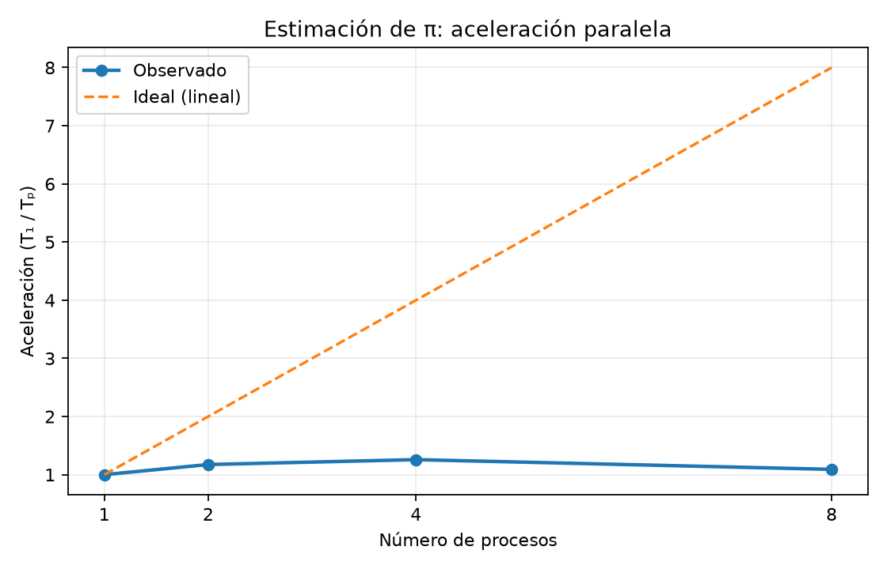
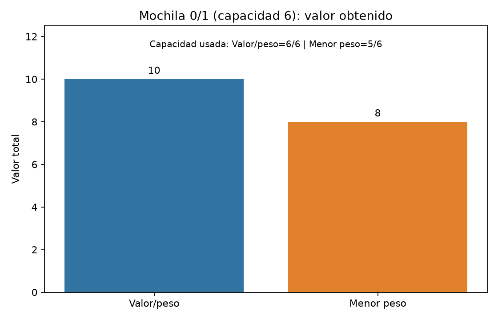
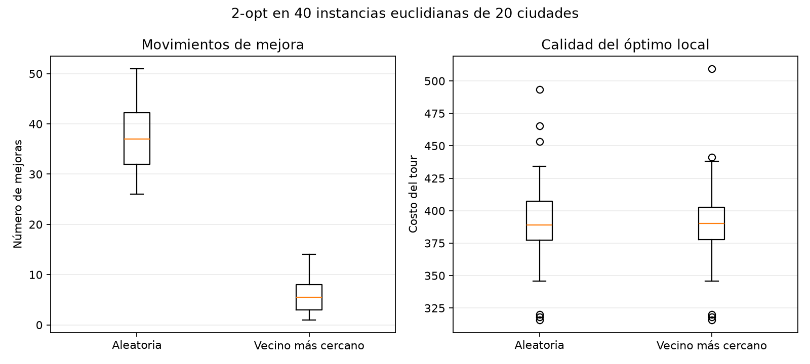
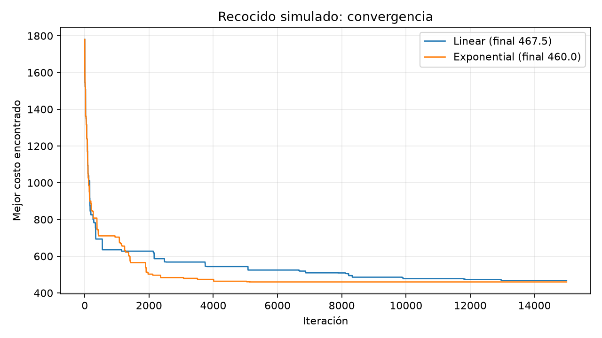
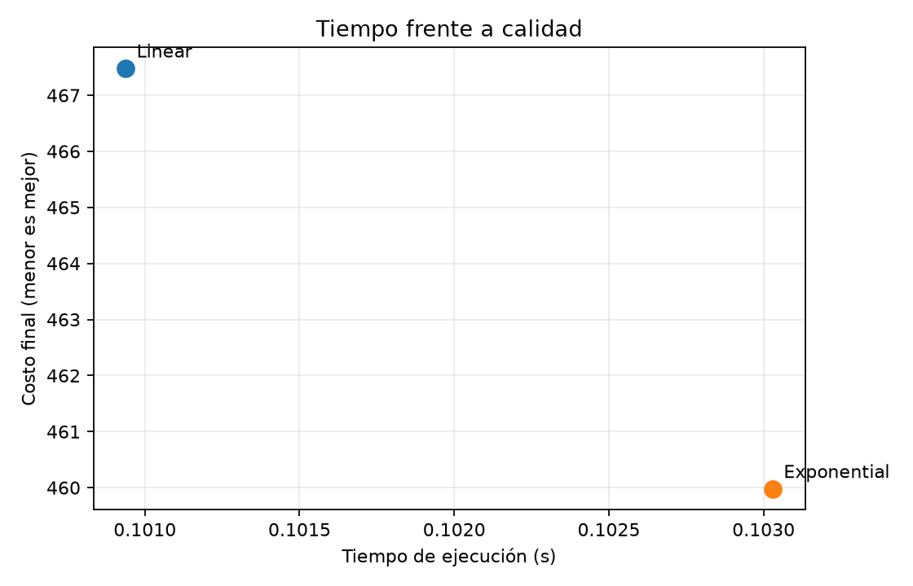
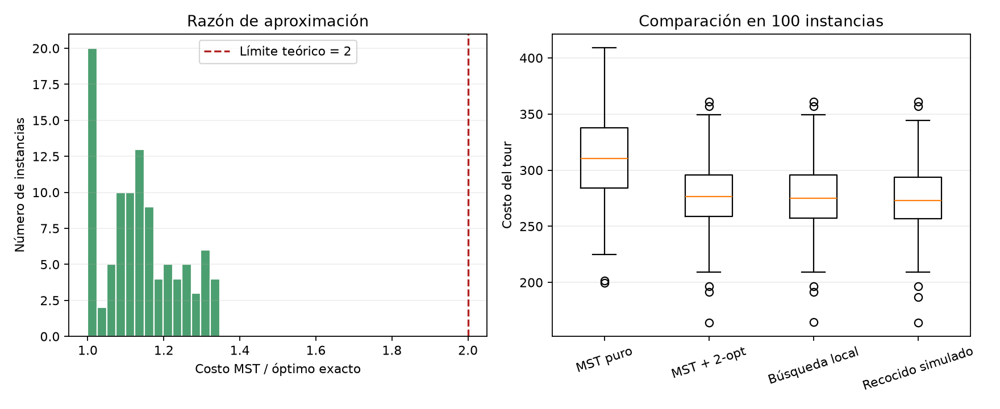

# Reporte: algoritmos de optimización

## Enlaces de entrega

- Repositorio público: https://github.com/abyssace/algoritmia
- Video demo (máximo 8 minutos): **pendiente de grabar y subir**.

## Metodología y reproducibilidad

Los experimentos se ejecutaron con semilla `20261025`. Los datos tabulares y figuras se encuentran en `../results/`. Los recorridos TSP usan distancia euclidiana (métrica), y el óptimo de las instancias de 9 ciudades se calculó exactamente mediante Held–Karp.

## Ejercicio 1 — Aceleración paralela

Se estimó π con 1.600.000 muestras y 1 proceso(s): 0.835 s, speedup 1.00×, 2 proceso(s): 0.711 s, speedup 1.17×, 4 proceso(s): 0.664 s, speedup 1.26×, 8 proceso(s): 0.765 s, speedup 1.09×. La aceleración no tiene por qué ser lineal: repartir trabajo y crear procesos cuesta tiempo, el sistema operativo comparte recursos y el cálculo tiene componentes seriales (ley de Amdahl). El paralelismo puede además saturar núcleos o ancho de banda; con esta carga y equipo el tiempo observado incluso puede empeorar en algunos niveles.

## Ejercicio 2 — Mochila voraz

Con capacidad 6 y objetos A=(peso 2, valor 3), B=(3,5), C=(3,5), el orden valor/peso selecciona **B, C**, usa 6 y obtiene valor 10; el orden por menor peso selecciona **A, B**, usa 5 y obtiene 8. Menor peso elige A y luego B, bloqueando C; este criterio local pierde frente a valor/peso. Ninguno de los dos voraces garantiza el óptimo para mochila 0/1.

## Ejercicio 3 — Búsqueda local 2-opt

Se compararon 40 instancias de 20 ciudades. El número medio de mejoras fue **37.5** desde una permutación aleatoria y **6.3** desde Vecino Más Cercano. **Sí: en este experimento Vecino Más Cercano necesitó menos mejoras para converger**, como muestran las cajas de movimientos. La caja de costos muestra la calidad del óptimo local: menos movimientos no implica necesariamente mejor calidad, pues el punto inicial cambia la cuenca de atracción.

## Ejercicio 4 — Recocido simulado

Ambos esquemas usaron la misma instancia de 30 ciudades, misma solución inicial y 15.000 iteraciones. El enfriamiento lineal obtuvo costo **467.48** en 0.101 s; el exponencial obtuvo **459.98** en 0.103 s. La forma de enfriar controla cuánto tiempo se aceptan movimientos peores: enfriar lentamente suele explorar más (posible mejor calidad y mayor coste), mientras un enfriamiento agresivo converge antes y puede quedarse atrapado. El tiempo puede ser parecido aquí porque el número de iteraciones es fijo; el costo, no obstante, depende también de la semilla y de la instancia.

## Ejercicio 5 — Aproximación MST

En 100 instancias aleatorias de 9 ciudades, la razón MST/óptimo tuvo media **1.138**, máximo **1.347** y permaneció por debajo del límite teórico 2. La garantía de 2 aplica al recorrido preorder del MST para distancias métricas; no implica que cada instancia alcance el límite. Held–Karp proporciona el óptimo de referencia.

Costos medios: MST puro: 312.32, MST + 2-opt: 276.78, Búsqueda local: 276.10, Recocido simulado: 274.71. El post-procesamiento 2-opt nunca empeora el tour MST (solo acepta intercambios estrictamente mejores) y normalmente lo acorta. Su mejora frente a búsqueda local/recocido depende de sus inicializaciones y presupuestos; aquí los métodos se comparan sobre las mismas 100 instancias, pero SA recibe 2.500 iteraciones por instancia.

## Archivos generados

- `parallel_speedup.csv`, `knapsack_comparison.csv`, `two_opt_comparison.csv`, `annealing_comparison.csv`, `mst_100_instances.csv`.
- Gráficas PNG correspondientes en `../results/`.
